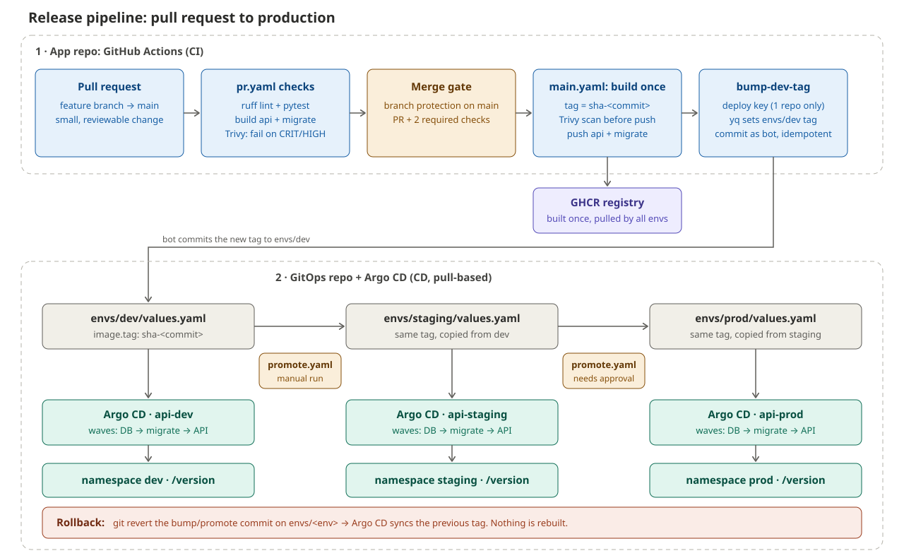

# release-pipeline-app

Application side of a small release pipeline prototype: a Python API, its database
migrations, and the GitHub Actions that test, scan, build and hand images over to GitOps.

Deployment config lives in the companion repo
[release-pipeline-gitops](https://github.com/abhishek-patwa-devops/release-pipeline-gitops).

## The flow



```
PR ──► pr.yaml (lint, tests, build + Trivy scan)  ──► review + required checks ──► merge to main
                                                                                       │
main ──► main.yaml: build api + migrate ──► Trivy scan ──► push to GHCR as sha-<7> ──► bump envs/dev tag in gitops repo
                                                                                       │
gitops repo ──► Argo CD syncs dev ──► promote.yaml: dev → staging → prod (prod needs approval)
```

The image is built **once**, on the merge commit, and tagged `sha-<short commit>`.
Staging and prod reuse that exact tag. Nothing is rebuilt during promotion.

## What is in here

| Path | What it is |
|---|---|
| `api/app.py` | Flask API: `/healthz` (liveness, no DB), `/readyz` (runs `SELECT 1`, returns 503 if the DB is down), `/version`, `/items` |
| `api/Dockerfile` | `python:3.12-slim`, OS packages upgraded, non-root user, `APP_VERSION` baked in at build time |
| `api/tests/` | pytest tests that run without a database |
| `migrations/` | Flyway image with versioned SQL (`V1__create_items.sql`) |
| `.github/workflows/pr.yaml` | PR checks: ruff + pytest, and a parallel job that builds both images and scans them with Trivy |
| `.github/workflows/main.yaml` | On merge: build, scan, push to GHCR, then commit the new tag to `envs/dev` in the gitops repo |

## PR checks (`pr.yaml`)

- **build-and-test**: `ruff check` (version pinned in `requirements-dev.txt`) and `python -m pytest`.
- **build-and-scan**: builds the api and migrate images and fails on fixable CRITICAL/HIGH CVEs.
- Both are **required status checks** in branch protection on `main`, and a PR is required to merge.
- The Trivy action is pinned to a commit SHA, not a tag, because tags can be moved.

## Build and hand-over (`main.yaml`)

1. Tag = `sha-${GITHUB_SHA::7}`, so every running pod can be traced back to a commit.
2. Build both images and pass the tag in as `APP_VERSION` (served on `/version`).
3. Scan both images with Trivy **before** pushing. A failing scan means nothing reaches the registry.
4. Push to GHCR, logging in with the workflow's own `GITHUB_TOKEN` (`packages: write`).
5. `bump-dev-tag` (`needs: build-and-push`) checks out the gitops repo with a **deploy key**
   (write access to that one repo only), sets `envs/dev/values.yaml` → `image.tag` with `yq`,
   and pushes as `release-pipeline-bot`. It skips the commit if dev already has that tag,
   so re-running the workflow is safe.

## Prerequisites

- Docker, to build and run the images locally.
- Python 3.12, to run the tests.
- To deploy: a Kubernetes cluster (I used kind), kubectl and Argo CD, set up as described in the
  [gitops repo](https://github.com/abhishek-patwa-devops/release-pipeline-gitops#prerequisites).
- For `main.yaml`: a deploy key with write access on the gitops repo, stored here as the
  `GITOPS_DEPLOY_KEY` secret. Images go to GHCR with the workflow's own `GITHUB_TOKEN`.

## Run locally

```bash
docker network create rp
docker run -d --name pg --network rp -e POSTGRES_USER=app -e POSTGRES_PASSWORD=changeme -e POSTGRES_DB=app postgres:16-alpine
docker build -t migrate ./migrations
docker run --rm --network rp -e FLYWAY_URL=jdbc:postgresql://pg:5432/app -e FLYWAY_USER=app -e FLYWAY_PASSWORD=changeme migrate migrate
docker build --build-arg APP_VERSION=local -t api ./api
docker run -d --name api --network rp -p 8080:8080 -e DATABASE_URL=postgresql://app:changeme@pg:5432/app api
curl localhost:8080/readyz && curl localhost:8080/version
```

Tests: `cd api && pip install -r requirements-dev.txt && python -m pytest -v`

## Assumptions

- The brief mentions a frontend. I left it out to keep the prototype focused; it would follow
  exactly the same pattern as the API (own image, same tag, own Deployment in the chart).
- One developer, so required approvals on PRs are switched off. Admins can bypass branch
  protection; in a team that would be a documented break-glass process only.
- Credentials in the chart are placeholders for a local cluster.

## Known limitations and what I would do next

- **Staging/prod promotion can't be blocked by test results yet.** Next step: smoke tests against
  dev (and staging) that must pass before promote is allowed.
- **CODEOWNERS** on `.github/workflows/`, with "Require review from Code Owners", so a PR
  can't weaken its own checks.
- **Dependabot** for GitHub Actions, pip and Docker base images, and pin every action by SHA
  (`checkout` and `setup-python` are still on version tags).
- Nightly Trivy scan of `main` so new base-image CVEs show up before they block a random PR.
- Docker layer cache and Trivy DB cache to keep PR checks fast.
- Distroless or smaller base images.
- Sign images (cosign) and generate an SBOM.

## Use of AI

I used an AI assistant (Claude) during this project, as the brief allows. I used it to explain
concepts (mainly Argo CD), review my YAML, help debug CI failures, and draft parts of the work:
the sample Flask app and its tests, the Postgres manifest, parts of the workflows and these
READMEs. I ran and tested everything myself and can walk through every file.
